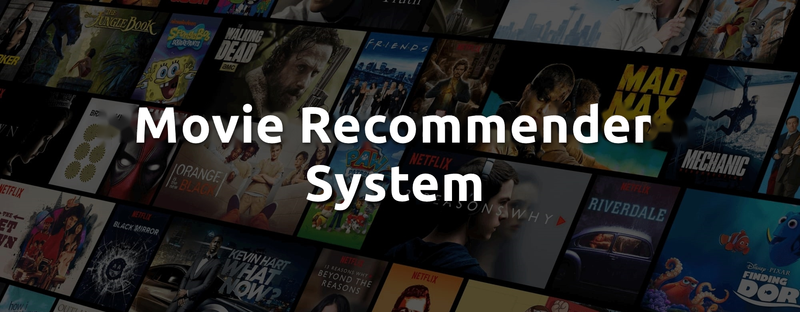
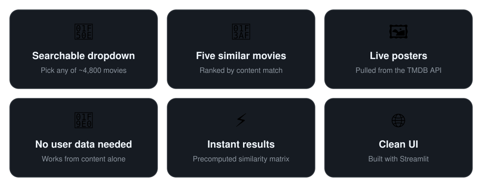

<!-- PROJECT BANNER -->

<!-- HEADER with DESCRIPTION -->
## 🎬 Movie Recommender System 🍿

A **content-based movie recommendation web app** built with **Python** and **Streamlit**. Select a movie and it returns the **five most similar titles** with their posters. Each of the ~4,800 TMDB movies is represented by its genres, keywords, top three cast members, director, and plot overview, vectorized with a **bag-of-words** model and ranked by **cosine similarity**.

 

## ✨ Features

  

 

## 🛠️ Tech Stack

- [x] **Frontend:** `Streamlit`
- [x] **Backend:** `Python`, `Requests`
- [x] **ML & Data Processing:** `Pandas`, `NumPy`, `scikit-learn (CountVectorizer, cosine_similarity)`, `NLTK (Porter stemmer)`
- [x] **Data & APIs:** `TMDB 5000 dataset, TMDB API (poster images)`
- [x] **Tools & Deployment:** `Jupyter Notebook`, `Pickle`, `Git LFS`, `Procfile`

 

| Category | Tools |
|---|---|
| **Frontend** | `Streamlit` |
| **Backend** | `Python`, `Requests` |
| **ML & Data Processing** | `Pandas`, `NumPy`, `scikit-learn (CountVectorizer, cosine_similarity)`, `NLTK (Porter stemmer)` |
| **Data & APIs** | `TMDB 5000 dataset`, `TMDB API (poster images)` |
| **Tools & Deployment** | `Jupyter Notebook`, `Pickle`, `Git LFS`, `Procfile` |

| Category | Tools |
|---|---|
| **Frontend** | Streamlit |
| **Backend** | Python, Requests |
| **ML & Data Processing** | Pandas, NumPy, scikit-learn (`CountVectorizer`, `cosine_similarity`), NLTK (Porter stemmer) |
| **Data & APIs** | TMDB 5000 dataset, TMDB API (poster images) |
| **Tools & Deployment** | Jupyter Notebook, Pickle, Git LFS, Procfile |
